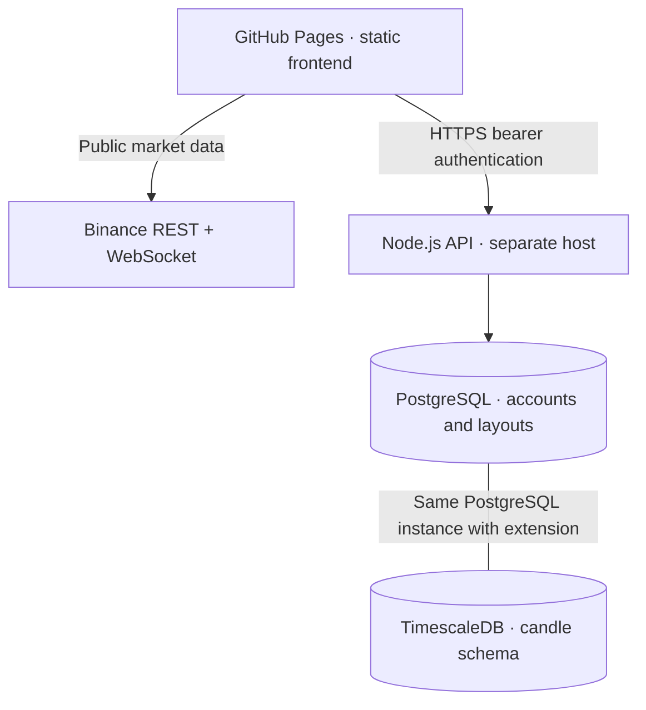

# HexaView — Phase 3, GitHub Pages edition

This package contains the complete Phase 1 frontend plus Phase 2 database design, Node.js API and workspace integration. Phase 3 adds the browser HexaScript editor, indicator AST/evaluator, tested server crossing core and alert schema/design. See [Phase 3 architecture](docs/PHASE_3.md). Always-on alert delivery is not deployed.

## Hosting layout

GitHub Pages hosts only the static Next.js export. It cannot run Node.js, PostgreSQL, TimescaleDB, or a WebSocket gateway. The API and database must run on a separate backend host. The live chart works without a backend using public Binance REST and WebSocket endpoints directly from the browser.



The TimescaleDB schema is implemented; continuous ingestion and a centralized WebSocket gateway are not implemented in Phase 2. The chart reads the exchange, not TimescaleDB.

## Start chart locally

Node.js 22+ is required. From the extracted `hexaview` directory:

```sh
npm ci
npm run dev
```

Open http://localhost:3000. No exchange API key is needed. If network-interface discovery fails in a restricted runtime, use `npm run dev -- --hostname 127.0.0.1`.

## GitHub Pages setup

1. Put the CONTENTS of `hexaview` at your GitHub repository root, including `.github/workflows/pages.yml`.
2. In Settings → Pages, choose **GitHub Actions** as the build/deployment source.
3. In Settings → Secrets and variables → Actions → Variables, create:
   - `PAGES_BASE_PATH`: `/YOUR_REPOSITORY_NAME` for a project site. Leave empty for `USERNAME.github.io` repositories or a custom domain hosted at the root. The value must start with `/` and have no trailing slash.
   - `API_URL`: your separately deployed HTTPS API origin, e.g. `https://api.example.com`. Leave empty to run the public chart without accounts.
4. Push to `main` or run the Deploy HexaView workflow manually.
5. The workflow builds `out/` and deploys it through GitHub Pages. Do not upload `node_modules`, `.env`, the server process, or database secrets to Pages.

Changing these public variables requires rebuilding. The API URL is public configuration, not a secret. Database credentials must never use `NEXT_PUBLIC_` names. Production frontend requests require an HTTPS API to avoid mixed-content blocking.

Repository: https://github.com/nore0135/HEXAVIEW

The workflow uses `/HEXAVIEW` as its base path. Enable GitHub Pages with GitHub Actions as its source. The frontend can operate in public chart mode until an HTTPS backend API is configured.

## Local backend and database

Use a PostgreSQL 17 instance with the TimescaleDB extension, or Docker Compose:

1. Create a root `.env` file containing a strong `POSTGRES_PASSWORD` (the file is ignored by Git).
2. Run `docker compose up -d database` from the project root.
3. Copy `server/.env.example` to `server/.env`. Set `DATABASE_URL` to match the database password, percent-encoding URL-special characters. Keep `ALLOWED_ORIGINS=http://localhost:3000` for local testing.
4. From `server` run:

```sh
npm ci
npm run migrate
npm run build
npm start
```

5. In the frontend root, create `.env.local` containing `NEXT_PUBLIC_API_URL=http://localhost:4000`; restart `npm run dev`.
6. Register with a handle of 3–30 lowercase letters/digits/underscores and a password of 12–128 characters. Save new layouts, load them, update them and sign out.

Compose uses a floating TimescaleDB development tag. Pin a tested image digest for production. Migrations run under an advisory lock and are transactional, recorded in `schema_migrations`. Never delete an existing database volume to apply a migration. Use a privileged migration account for extension creation; the API's production database role should have only needed DML rights.

For backend hosting, run commands with `server` as the working directory, migrate first, then build and start. Inject DATABASE_URL, ALLOWED_ORIGINS, PORT and HOST through the host's secret manager. If the host injects environment variables rather than providing a `.env` file, run `node dist/index.js` instead of the `.env`-loading npm start command. Set HOST=0.0.0.0 on container hosts. ALLOWED_ORIGINS is the exact browser origin, e.g. `https://USERNAME.github.io`, with no repository path. Require TLS on the API and database connection in production.

## Implemented API

All requests/responses are JSON except 204 responses. Protected routes use `Authorization: Bearer TOKEN`.

| Method | Path | Purpose |
|---|---|---|
| GET | /health | Database connectivity check |
| POST | /auth/register | Create user + social profile atomically and issue session |
| POST | /auth/login | Verify password and issue session |
| POST | /auth/logout | Revoke current session |
| GET | /auth/me | Read current user/profile |
| GET | /workspaces | List up to 100 most recently updated owned layouts |
| POST | /workspaces | Create a layout |
| GET | /workspaces/:id | Read an owned layout |
| PUT | /workspaces/:id | Update an owned layout using optimistic version check |
| DELETE | /workspaces/:id | Delete an owned layout |

Registration body:
```json
{"email":"you@example.com","password":"choose-a-strong-password","handle":"your_handle","displayName":"Your Name"}
```
Login body uses only `email` and `password`. Authentication returns `user`, `token`, and `expiresAt`.

Workspace creation body:
```json
{"name":"BTC intraday","state":{"schemaVersion":1,"symbol":"BTCUSDT","interval":"5m","showSma":true,"script":"calculate SMA 50"}}
```
For PUT, include the current integer `version` from the last read/save. A conflicting version returns 409; missing or unowned IDs return 404. The current saved layout records symbol, interval, SMA setting and optional HexaScript source; viewport/drawings are not yet persisted.

## Data model

- `users`: UUID identity, unique normalized email, scrypt password hash.
- `social_profiles`: one-to-one user profile, unique handle, display name, bio/avatar.
- `published_ideas`: author, title/body, symbol, chart JSON, visibility and feed index. Schema only; publishing endpoints are outside Phase 2.
- `chart_workspaces`: owner, name, JSON state, integer version and timestamps.
- `sessions`: SHA-256 hash of random 256-bit bearer token, owner and expiry.
- `candles`: TimescaleDB hypertable with venue, symbol, timeframe, open time, decimal OHLCV, closed flag and source event time. Composite primary key includes the time partition column. Schema supports multiple timeframes without mixing their rows.

The intended ingestion UPSERT uses the composite key, rejects older source events, and never reopens a finalized candle. No automatic ingestion, retention or aggregation job is deployed yet.

## Security and operational boundaries

Passwords use salted scrypt; raw session tokens are never stored in the database. Sessions expire after one hour; logout revokes them. Browser tokens are kept in React memory, not persistent browser storage; reloading requires signing in again. All layout SQL is parameterized and owner-scoped. Request bodies and chart state are validated. Responses are no-store; authorization headers are redacted from logs. CORS allows only configured origins; CORS is not authentication.

Rate limits are per-process/IP and trustProxy is false. When deploying behind a proxy, configure only known trusted proxy addresses and distributed rate limiting before scaling. Email verification, password recovery, MFA, account deletion UI and distributed anti-abuse controls are not included. Do not treat this as a finished public financial service. Schedule cleanup of expired session rows (`DELETE FROM sessions WHERE expires_at < now()`) on the backend. Database backup, monitoring and production incident handling remain deployment tasks.

## Verification

Passed: ten frontend data/parser/indicator tests; static Next.js export with `/hexaview` base path; backend strict TypeScript build; ten backend tests covering crossing behavior, resource bounds, password hashes, layout validation, authentication, ownership scoping and version conflicts.

Backend HTTP tests use Fastify injection and mocked database responses. PostgreSQL/TimescaleDB binaries and Docker are unavailable in the generation environment: migrations and database-backed end-to-end behavior have **not** been executed here. Browser UI and sustained WebSocket reconnection behavior also remain manual checks. This package is not claimed to be load-tested enterprise production software.

```sh
npm test
npm run build
cd server
npm test
npm run build
```

Before deployment: apply migrations to a clean test database; register two accounts; confirm each can save/load only its own layouts; test stale-version 409 responses and session expiry/logout. Verify every timeframe, SMA toggle, responsive controls, and offline/reconnect history repair. Verify Pages asset URLs use your exact repository path.

Lightweight Charts by TradingView retains its attribution link/logo and upstream notices in THIRD_PARTY_NOTICES.md.
