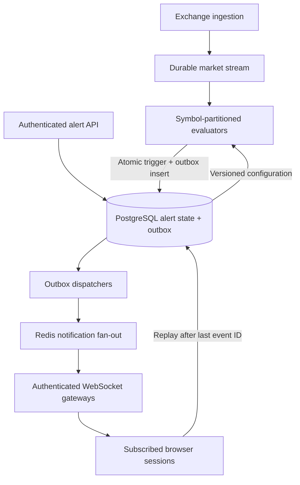

# Phase 3 — HexaScript and alert architecture

## Delivered vs planned

Delivered on GitHub Pages: HexaScript editor, safe parser/AST, SMA/EMA evaluation and Canvas plots that recalculate with live candles. Scripts persist as optional workspace state when the Phase 2 backend is configured. Old workspaces remain valid.

Delivered as server source: tested one-shot price crossing evaluator and SQL migration for price alerts and a durable outbox. The distributed worker, ingestion adapter, notification gateway, alert CRUD API and delivery UI are architectural designs below, not deployed services. No UI claims always-on alerts are active.

## Grammar and AST

```text
program   := (statement | comment | blank-line)+
statement := "calculate" ("SMA" | "EMA") integer [comment]
comment   := "#" text-to-end-of-line
```

Commands are case-insensitive. One statement per line. Source limit: 2,048 characters; up to four distinct indicators; periods 1–500; at most 1,000 strictly ordered finite-price bars. No variables, user functions, loops, network access, dynamic imports, `eval`, or JavaScript execution. Complexity is bounded by four passes over 1,000 bars.

```typescript
interface IndicatorNode {
  type: "Indicator";
  kind: "SMA" | "EMA";
  period: number;
  line: number;
}
interface Program {
  type: "Program";
  version: 1;
  body: IndicatorNode[];
}
```

The parser tokenizes each non-comment line, checks grammar/limits, and produces typed nodes with source line numbers. The interpreter walks only these node types. SMA requires a complete trailing window. EMA starts with a full SMA seed and uses alpha=2/(period+1). Calculations use candle closes, including the current incomplete candle. Re-evaluation starts from the data array, so repeated live updates do not double-count EMA history. Floating point is appropriate for display, not financial accounting.

Example:
```text
# Close-price trend
calculate SMA 50
calculate EMA 20
```

Each AST node becomes a dedicated chart line; changing/removing a script cleans up its old series. Invalid editor input preserves the previously applied script. Indicators warm up only when sufficient candles are present. EMA values depend on the fetched history window; older-history seeding can differ from other platforms.

## Target always-on alert architecture



The final replay arrow denotes a backend-authorized API query, never a direct browser database connection.

### Ingestion and ordering

Use one normalized exchange subscription per market partition, not a feed per browser or alert. Partition a durable stream (Kafka or Redis Streams) by venue+symbol. Use exchange trade sequence IDs and explicit feed epochs; preserve order inside a partition. Commit consumer offsets only after a successful durable state transaction. Reject duplicate/older sequences, detect missing ranges, and backfill before crossing evaluation. Kline close updates alone cannot guarantee detection of transient price crossings; use ordered trades for trade-price alerts.

### Evaluation

`server/src/alert-engine.ts` is a deterministic in-memory core. It indexes one-shot alerts per symbol and direction in sorted threshold arrays. A tick uses binary bounds to identify crossed thresholds. Query lookup is O(log n + k), but inserting/removing array elements can shift O(n) entries. Replace arrays with a balanced ordered index or price buckets for high configuration churn; do not claim the prototype has achieved a throughput SLA.

Semantics: crosses_above requires previous <= threshold and current > threshold; crosses_below requires previous >= threshold and current < threshold. An exact touch does not fire. The first observed sample establishes the baseline. Same-sequence and older ticks are ignored. Cancellation removes the rule. `resetBaseline` prevents asserting an unseen crossing after a gap; production ingestion should recover the gap when possible. The core is one-shot, with a default 100,000-rule cap, and emits user-scoped event candidates. It does not perform notification delivery or use socket state as alert state.

The core consumes triggered rules in memory. The worker MUST checkpoint the pre-evaluation state or reconstruct the affected partition from persisted active rules and its prior offset on transaction failure. Do not acknowledge the input or continue with a consumed in-memory state after a failed database write.

### Atomic state and outbox

Within one database transaction, lock/update each active rule only if its configuration version is still current, set status=triggered, and insert its event into `alert_outbox`. The unique alert_id constraint enforces one durable event per one-shot alert. A cancellation/version change winning the race prevents a stale trigger. Save the partition cursor/baseline in the same transactional boundary (a worker-checkpoint table is still to be implemented). This provides deduplicated storage with at-least-once transport, not a claim of exactly-once network delivery.

Dispatchers lease outbox rows using short transactions and `FOR UPDATE SKIP LOCKED`, increment attempts, and retry with backoff. Commit a lease before network calls. Do not hold row locks while waiting for a WebSocket. Mark delivered only according to a documented gateway/client acknowledgement policy; retain events for reconnect replay. Redis Pub/Sub alone loses events for disconnected subscribers, so it is only a low-latency signal over durable state.

### Thousands of sockets

Gateways authenticate using the session system, enforce ownership on subscription and replay, and keep user-to-connection mappings. Never accept user IDs from untrusted clients as authorization. Partition notification channels by user/shard and avoid broadcasting private alerts to all clients. Use heartbeat timeouts, per-user connection limits, bounded outbound queues, and maximum message sizes. Disconnect slow consumers and allow event-ID replay. Never place bearer tokens in WebSocket URLs or logs; use an initial authentication message over WSS with a short timeout or a short-lived single-use handshake ticket. Revalidate expiry/revocation.

Always-on operation requires independently deployed backend workers, a database, a durable stream, Redis fan-out and gateways. GitHub Pages serves only the static client.

### Required pre-production validation

- Real PostgreSQL/TimescaleDB migration and trigger/outbox transaction tests.
- Crash/restart tests between rule transition, outbox insertion and offset acknowledgement.
- Cancellation/trigger races, stale configuration and duplicate stream delivery.
- Cross-user authorization and expired/revoked WebSocket sessions.
- Burst and sustained load tests with 10,000 sockets, slow readers and realistic alert counts; measure CPU, memory, p95/p99 latency, lag, reconnect recovery and drop rates. This is a target test scenario, not a completed benchmark.
- Feed gap, backfill and exchange reconnect tests using replayable fixtures.

## Verification performed

Unit coverage includes grammar rejection, AST generation, SMA/EMA results, warm-up, live-candle recomputation, memory limits, crossing equality rules, duplicates, out-of-order ticks, symbol isolation, cancellation and a 10,000-rule selection fixture. The fixture is a correctness test, not a 10,000-connection load test.

Database migrations, a production distributed alert pipeline and browser end-to-end interactions are not verified in the current environment.

## Primary references

- https://redis.io/docs/latest/develop/pubsub/ — Pub/Sub delivery semantics.
- https://www.postgresql.org/docs/18/sql-select.html — SKIP LOCKED for queue consumers.
